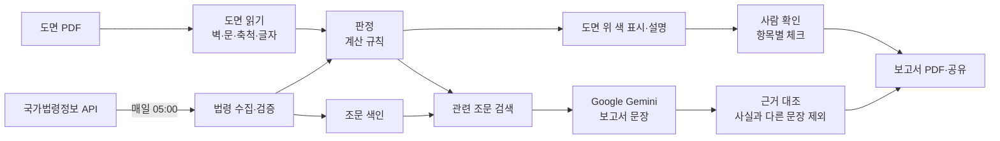

# SafeCert

평면도(PDF)를 올리면 현행 소방 법령 기준으로 도면 위에 안전상태를 색으로 표시하고, 사람이 항목마다 확인한 뒤, AI 가 쓴 설명을 담은 검토 보고서(PDF)로 내보내는 iPad·iPhone 앱.

## 프로젝트 소개

노래연습장·PC방·음식점 같은 **다중이용업소**는 문을 열기 전에 비상구 위치·크기 등 소방 안전 기준을 지켜야 합니다. 기준은 여러 법령에 나뉘어 있고 수시로 바뀌어, 설계 단계에서 놓치면 허가 단계에서 다시 설계·공사를 하게 됩니다. SafeCert 는 도면 단계에서 이 위험을 미리 찾아 줍니다.

**MVP**: PDF 도면 올리기 → 현행 법령 기준 충족 여부를 도면 위에 색으로 표시 → 사람이 항목마다 확인(체크) → PDF 보고서 내보내기

| 색 | 뜻 |
|---|---|
| 빨강 | 의무 미충족 |
| 주황 | 위반 가능성 · 확인 필요 |
| 노랑 | 법령 변경 영향 |
| 초록 | 확인 범위 안에서 기준 충족 |
| 회색 | 자료 부족 · 대상 아님 |

결과는 모두 「감수 전 · 참고용」입니다. 최종 확인은 자격 있는 전문가가 합니다.

## 팀원 및 역할

작성 예정

## 기술 스택

| 영역 | 기술 |
|---|---|
| 앱 | iPad·iPhone 앱 — Swift · SwiftUI · SwiftData (외부 라이브러리 없음) |
| 도면 읽기 | 애플 PDF 분석(CoreGraphics · PDFKit) · 글자 인식(Vision) |
| 법령 | 국가법령정보 공동활용 Open API |
| 생성형 AI | Google Gemini API (`gemini-3.5-flash-lite`, 무료 등급) |
| 보고서 | PDF 직접 생성(CoreText) |
| 배포 | TestFlight |

선택 이유는 [기획서](docs/기획서.md#5-기술-선택과-이유).

## 시스템 구조



## 핵심 AI 활용

| 방식 | 하는 일 |
|---|---|
| 생성형 AI (Gemini) | 보고서의 요약 · 판정 설명 · 보완 방향 문장 작성. 정해진 형식(JSON)으로 받음 |
| RAG | 매일 모은 법령 전문(약 280개 조각)에서 판정마다 관련 조문을 찾아 AI 에 함께 전달 |
| 자동화 워크플로우 | 매일 법령 수집 → 조문 추출 → 서로 다른 방법 2가지로 기준 정리 → 자동 검증 5가지 → 반영 |
| 근거 대조 | AI 문장을 판정 결과와 하나씩 비교해 없는 숫자 · 틀린 색 · 단정 표현이 든 문장은 뺌 |

판정(맞다/아니다)은 AI 가 아니라 정해진 계산 규칙이 합니다. 같은 도면이면 언제나 같은 결과가 나옵니다. 자세한 내용은 [기능 요구 명세서](docs/기능%20요구%20명세서.md#5-ai-활용-명세).

## 실행 방법

요구: Mac(Xcode 27) · iPadOS·iOS 26 이상 iPad·iPhone 또는 시뮬레이터

```sh
git clone https://github.com/sujileelea/safecert-open.git
cd safecert-open

# 로직 시험 (macOS)
cd packages/SafeCertKit && swift test

# iPad 앱 (시뮬레이터)
cd ../../apps/ipad && xcodebuild -project SafeCert.xcodeproj -scheme SafeCert \
  -destination 'platform=iOS Simulator,name=iPad Pro 13-inch (M5)' build
```

- AI 문장: 앱 「설정」에 Gemini API 키를 넣으면 쓸 수 있습니다(키가 없으면 규칙으로 만든 문장으로 보고서 작성).
- 시연용 샘플 도면 3종이 앱 안에 있습니다.
- 개발자용 상세: [개발 안내](docs/개발%20안내.md)

## 결과

- MVP 흐름 구현 완료 — 도면 올리기 → 색 표시 → 사람 확인 → PDF 보고서
- 자동 시험 84개 통과
- 정부 법령 API 실제 호출로 그날 법령 기준 생성 · 자동 검증 5가지 통과
- 생성형 AI 실제 호출 시험: 판정 4건 + 요약에 문장 20개 작성 · 검사에서 1개 제외 · 약 8초
- 실제 설계 도면 1건으로 읽기 시험 → 축소 인쇄 · 그림으로 저장된 글자 등 대응
- 사용자 테스트 결과: 작성 예정

## 문서

| 문서 | 내용 |
|---|---|
| [요구사항 충족 현황](docs/요구사항%20충족%20현황.md) | 과제 요구사항별 충족 여부 |
| [기획서](docs/기획서.md) | 기획의도 · 핵심 포인트 · 문제 · 대상 사용자 · 해결 방법 · AI 활용 · 기술 선택 · 일정 |
| [기능 요구 명세서](docs/기능%20요구%20명세서.md) | 기능 · 비기능 요구사항 · 시스템 구조 · AI 활용 명세 |
| [진행 기록](docs/진행%20기록.md) | 날짜별로 한 일과 결과 |
| [개인정보 처리방침](docs/개인정보%20처리방침.md) | 기기 안에 두는 것 · 밖으로 보내는 것 |

## 링크

- 배포(TestFlight 공개 링크, iPad·iPhone): https://testflight.apple.com/join/7g7tebXZ — 애플 베타 심사 통과 후 참여 가능 · 선착순 100명
- 발표 자료: 준비 중
