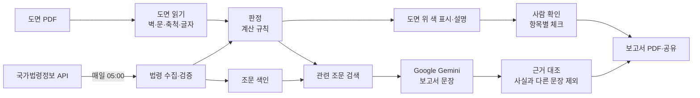

# SafeCert 기능 요구 명세서

## 1. 개요

- 이름: SafeCert (사전 파일럿)
- 목적: 다중이용업소 평면도의 소방 안전 기준(비상구) 사전 점검과 검토 보고서 작성
- 대상: 인테리어·설계 실무자, 소방시설 업체, 창업 예정자
- MVP: PDF 도면 올리기 → 현행 법령 기준 충족 여부를 도면 위에 색으로 표시 → 사람이 항목마다 확인(체크) → PDF 보고서 내보내기
- 판정 기준: 비상구 3가지 — 설치 여부 · 위치(주 출입구와의 거리) · 크기

## 2. 기능 요구사항

| ID | 기능 | 설명 | 우선순위 | 상태 |
|---|---|---|---|---|
| FR-01 | 도면 올리기 | PDF 도면 불러오기 · 시연용 샘플 도면 3종 | 필수 | 구현 (파일 앱에서 직접 올리기는 실기기 점검 예정) |
| FR-02 | 도면 자동 읽기 | 벽 · 문 · 영업장 외곽 · 출입구 · 축척 자동 인식. 글자가 그림으로 저장된 도면은 글자 인식 | 필수 | 구현 |
| FR-03 | 확인·수정 | 자동으로 읽은 축척과 조건(업종·층 등)을 사용자가 확인·수정 | 필수 | 구현 |
| FR-04 | 법령 자동 수집 | 매일 05:00, 앱 실행·판정 직전에 정부 API 로 법령 수집·검증 | 필수 | 구현 |
| FR-05 | 판정 | 비상구 3가지 기준 판정 | 필수 | 구현 |
| FR-06 | 도면 위 색 표시 | 판정 결과를 해당 위치에 5가지 색으로 | 필수 | 구현 |
| FR-07 | 판정 설명 | 판정마다 위치 · 읽은 값 · 기준 · 법 조문 원문 | 필수 | 구현 |
| FR-08 | 사람 확인 | 판정 항목마다 확인 체크(체크 시각 기록). 도면 표식 · 결과 목록 · 보고서에 함께 표시 | 필수 | 구현 |
| FR-09 | 검토 보고서 내보내기 | 확인 여부 + 조문 검색 + 생성형 AI 설명 → PDF 만들기 · 공유 | 필수 | 구현 |
| FR-10 | 검토 기록 | 검토 · 판정 · 확인 · 보고서를 보관하고 다시 열기 | 권장 | 구현 |
| FR-11 | 첫 실행 안내 | 처음 열 때 사용 순서 · AI 로 보내는 범위 · 개인정보 안내 | 필수 | 구현 |
| FR-12 | 의견 보내기 | 앱 안 짧은 설문(역할 · 점수 · 좋았던 점 · 고칠 점)을 메일·메시지 등으로 보냄 | 필수 | 구현 |

## 3. 비기능 요구사항

| ID | 항목 | 요구사항 |
|---|---|---|
| NFR-01 | 판정 일관성 | 같은 도면 · 같은 법령 기준이면 언제나 같은 판정 |
| NFR-02 | 안전한 판정 | 확인하지 못한 항목은 「충족」으로 표시하지 않음 |
| NFR-03 | 법령 최신성 | 매일 갱신. 수집 실패 시 마지막 기준을 쓰고 경고 표시 |
| NFR-04 | 개인정보 | 도면은 기기 밖으로 보내지 않음. AI 에는 판정 결과 글과 법 조문만, 보낼 때마다 동의 |
| NFR-05 | AI 표시 | AI 가 쓴 문장마다 「AI 작성」 표시 |
| NFR-06 | 응답 시간 | 판정 수 초 · 보고서 1분 이내(목표) |

## 4. 시스템 구조

- 처리는 모두 iPad 안에서 함
- 밖과 통신하는 것은 두 가지뿐 — 법령 수집(정부 API) · 보고서 문장 작성(Gemini)

## 5. AI 활용 명세

| 기능 | 방식 | 상세 |
|---|---|---|
| 보고서 문장 | 생성형 AI (Gemini) | 판정 결과와 관련 조문을 주고, 요약 · 판정 설명 · 보완 방향을 정해진 형식(JSON)으로 받음 |
| 근거 조문 찾기 | RAG | 법령 전문을 약 280개 조각으로 나눠 두고, 판정마다 관련 조각 2개를 찾아 AI 입력과 보고서 부록에 사용 |
| 법령 최신화 | 자동화 워크플로우 | 수집 → 조문 추출 → 기준 정리(서로 다른 방법 2가지로 정리해 일치 확인) → 자동 검증 5가지 → 반영 |
| 도면 글자 | 이미지 인식 | 그림으로 저장된 도면 글자를 세 방향(0°·90°·270°)으로 읽음 |

### AI 에게 주는 지시 (프롬프트)

- 주어진 사실과 조문만 쓰고, 없는 숫자·조항은 만들지 않음
- 판정 색과 결과를 그대로 전하고, 「적합」「부적합」 같은 단정은 쓰지 않음
- 벌금·비용 금액은 쓰지 않음, 보고서 문체로
- 정해진 형식(JSON)으로만 답하게 해서 보고서에 바로 배치

### AI 문장 검사 (근거 대조)

AI 가 쓴 문장을 하나씩 판정 결과와 비교해 아래에 해당하면 뺌. 모두 빠지면 규칙으로 만든 문장으로 대신함.

- 판정에 없는 숫자
- 판정에 없는 색, 또는 색과 항목의 짝이 틀림
- 단정 · 금액 표현
